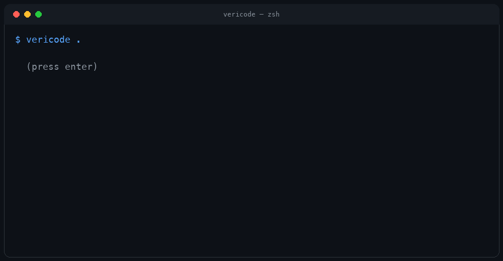
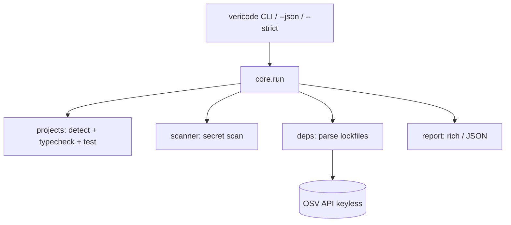

<div align="center">


# VeriCode

**Verify AI-generated code actually works — locally, no config.**

Type-check · run tests · scan for hardcoded secrets · check dependencies for known CVEs.
One command. Zero setup. Your code never leaves your machine (CVE lookup is keyless & anonymous).

[](https://github.com/LucasXlab/vericode/actions)
[](LICENSE)
[](https://www.python.org/)
[](https://github.com/LucasXlab/vericode#quick-start)

</div>

---

## Demo



```bash
$ pip install -e .
$ cd my-ai-project
$ vericode .

  VeriCode · /home/you/my-ai-project
┏━━━━━━━━━━━┳━━━━━━┳━━━━━━━━━━━━━━━━━━━━━━━━━━━━━━━━━━━━┓
┃ Check     ┃ Status ┃ Detail                               ┃
┡━━━━━━━━━━━╇━━━━━━┇━━━━━━━━━━━━━━━━━━━━━━━━━━━━━━━━━━━━┩
│ typecheck │ –      │ mypy/pyright not installed          │
│ tests     │ ✓      │ pytest: passed                      │
└───────────┴────────┴────────────────────────────────────┘
✓ No hardcoded secrets detected
✓ No known vulnerabilities in dependencies

Result: All checks passed (1 skipped)
```

> The GIF is rendered from **real `vericode` stdout** (captured with
> `vericode . --no-cve --exclude tests`). This environment has no `vhs` / `asciinema`,
> so these are terminal renderings rather than a screen recording. [`demo.tape`](demo.tape)
> is kept so `vhs demo.tape` can produce a true recording where vhs is available.

| Pretty report | JSON for CI | CLI help |
|---|---|---|
|  |  |  |

> **Known limit:** a failing CVE lookup degrades to an empty result. A green
> "No known vulnerabilities" line means *no findings returned*, not *lookup verified*.
> Use `--no-cve` when offline, and don't treat that line as a security guarantee.

## Why

AI coding agents write code that *looks* right but often isn't. VeriCode is the
"trust but verify" layer you run before you commit, open a PR, or ship.

| | VeriCode | gitleaks | Snyk | Dependabot | `grep` |
|---|---|---|---|---|---|
| Secret scanning | ✅ built-in | ✅ | ✅ | ❌ | ⚠️ |
| Type-check / test run | ✅ | ❌ | ❌ | ❌ | ❌ |
| Dependency CVE (keyless) | ✅ | ❌ | ✅ (account) | ✅ (PR only) | ❌ |
| Local-first / no account | ✅ | ✅ | ❌ | ❌ | ✅ |
| One command for all of it | ✅ | ❌ | ❌ | ❌ | ❌ |

## Quick Start

```bash
git clone https://github.com/LucasXlab/vericode.git && cd vericode
pip install -e .
vericode .                 # scan the current project
```

> **Install note:** the PyPI name `vericode` is already taken by an unrelated
> 2025 package (a pylint/flake8 wrapper by a different author). Until this project
> publishes under a distinct name, install from the repository above — `pip install vericode`
> would install the wrong tool. The distribution name in `pyproject.toml` is `vericode-cli`;
> the command is still `vericode`.

## Features

- **Project detection** for Python, Node, Go and Rust (extensible).
- **Type-check**: `mypy`/`pyright`, `tsc --noEmit`, `go vet`, `cargo check`
  (honestly skips when the tool isn't installed).
- **Tests**: `pytest`, `npm test`, `go test`, `cargo test`.
- **Secret scanning**: dependency-free regex + Shannon-entropy heuristics for
  AWS / private keys / Slack / Stripe / GitHub / GitLab tokens, JWTs and
  generic `api_key = "..."` assignments.
- **CVE check**: parses `requirements.txt`, `Pipfile.lock`, `package-lock.json`,
  `go.mod`, `Cargo.lock` and queries the free, keyless [OSV API](https://osv.dev).
- **`--json`** for machine consumption, **`--strict`** for CI, **`--no-cve`**
  to skip the network, **`--exclude`** to ignore paths.

> **Secret values are masked by default.** A scanner that prints the credential it
> found becomes a liability the moment its output is pasted into a CI log or a bug
> report, so findings show `api_key = '********'` and keep the file/line for you to
> jump to. Pass `--reveal-secrets` when you deliberately want the raw value (e.g.
> fixing the line locally) — and don't redirect that output into a shared log.

## Architecture



## Roadmap

- [ ] SARIF output for GitHub code scanning
- [ ] HTML report
- [ ] Historical trend comparison
- [ ] Configurable rule allow/deny lists

## Contributing

See [CONTRIBUTING.md](CONTRIBUTING.md). Small, atomic PRs welcome.

## License

[MIT](LICENSE) © 2026 Noah Forge
