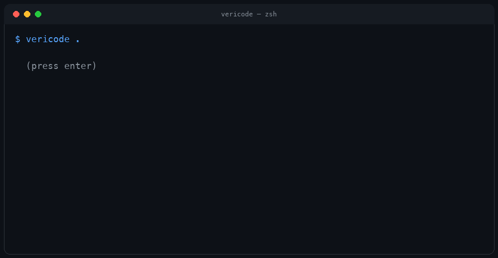
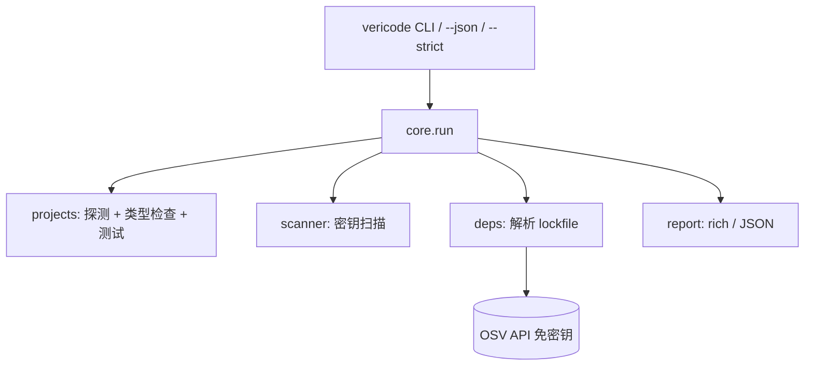

<div align="center">


# VeriCode

**验证 AI 生成的代码真的能用 —— 本地运行，零配置。**

类型检查 · 跑测试 · 扫描硬编码密钥 · 检查依赖已知漏洞。
一条命令，无需配置，代码不出本机（CVE 查询免密钥、匿名）。

[](https://github.com/LucasXlab/vericode/actions)
[](LICENSE)
[](https://www.python.org/)
[](https://github.com/LucasXlab/vericode#quick-start)

</div>

---

## 演示



```bash
$ pip install -e .
$ cd my-ai-project
$ vericode .

  VeriCode · /home/you/my-ai-project
┏━━━━━━━━━━━┳━━━━━━┳━━━━━━━━━━━━━━━━━━━━━━━━━━━━━━━━━━━━┓
┃ Check     ┃ Status ┃ Detail                               ┃
┡━━━━━━━━━━━╇━━━━━━┇━━━━━━━━━━━━━━━━━━━━━━━━━━━━━━━━━━━━┩
│ typecheck │ –      │ mypy/pyright not installed          │
│ tests     │ ✓      │ pytest: passed                      │
└───────────┴────────┴────────────────────────────────────┘
✓ No hardcoded secrets detected
✓ No known vulnerabilities in dependencies

Result: All checks passed (1 skipped)
```

> GIF 由**真实 `vericode` stdout** 渲染而成（采集命令 `vericode . --no-cve --exclude tests`）。
> 本环境没有 `vhs` / `asciinema`，因此是终端帧渲染，不是屏幕录屏。保留 [`demo.tape`](demo.tape)，
> 在装有 vhs 的机器上执行 `vhs demo.tape` 可生成真正的录屏。

| 终端报告 | CI 用 JSON | 命令帮助 |
|---|---|---|
|  |  |  |

> **已知限制**：CVE 查询失败会静默降级为空结果。「未发现已知漏洞」表示*没有返回结论*，
> 不等于*查询已验证*。离线请用 `--no-cve`，且不要把这行当作安全保证。

## 为什么需要它

AI 编码 Agent 写出来的代码「看起来对」但常常不对。VeriCode 是你在提交、开 PR
或上线之前的那道「先验证再信任」关卡。

| | VeriCode | gitleaks | Snyk | Dependabot | `grep` |
|---|---|---|---|---|---|
| 密钥扫描 | ✅ 内置 | ✅ | ✅ | ❌ | ⚠️ |
| 类型检查 / 跑测试 | ✅ | ❌ | ❌ | ❌ | ❌ |
| 依赖 CVE（免密钥） | ✅ | ❌ | ✅（需账号） | ✅（仅 PR） | ❌ |
| 本地优先 / 免账号 | ✅ | ✅ | ❌ | ❌ | ✅ |
| 一条命令全包 | ✅ | ❌ | ❌ | ❌ | ❌ |

## 快速开始

```bash
git clone https://github.com/LucasXlab/vericode.git && cd vericode
pip install -e .
vericode .                 # 扫描当前项目
```

> **安装说明**：PyPI 上的 `vericode` 名字已被 2025 年另一个作者发布的同名包
> （pylint/flake8 包装器）占用。本项目改用 `vericode-cli` 作为发行名、命令仍是 `vericode`；
> 在改用独立名字发布前，请从本仓库安装，直接 `pip install vericode` 会装错工具。

## 功能

- **项目探测**：自动识别 Python / Node / Go / Rust（可扩展）。
- **类型检查**：`mypy`/`pyright`、`tsc --noEmit`、`go vet`、`cargo check`
  （工具未安装时诚实跳过）。
- **测试**：`pytest`、`npm test`、`go test`、`cargo test`。
- **密钥扫描**：零依赖的正则 + 香农熵启发式，覆盖 AWS / 私钥 / Slack /
  Stripe / GitHub / GitLab Token、JWT 以及通用的 `api_key = "..."` 赋值。
- **CVE 检查**：解析 `requirements.txt`、`Pipfile.lock`、`package-lock.json`、
  `go.mod`、`Cargo.lock`，并查询免费、免密钥的 [OSV API](https://osv.dev)。
- **`--json`** 供程序消费，**`--strict`** 用于 CI，**`--no-cve`** 跳过联网，
  **`--exclude`** 忽略指定路径。

> **密钥值默认打码。** 一个会把发现的凭证原样打印出来的扫描器，一旦输出被贴进
> CI 日志或 issue 就会变成新的风险源。因此结果里只显示 `api_key = '********'`，
> 同时保留文件与行号供你跳转定位。确实需要原文时（例如本地修那一行）加
> `--reveal-secrets`——但别把它的输出重定向到共享日志。

## 架构



## 路线图

- [ ] SARIF 输出，接入 GitHub code scanning
- [ ] HTML 报告
- [ ] 历史趋势对比
- [ ] 可配置的规则白/黑名单

## 贡献

见 [CONTRIBUTING.md](CONTRIBUTING.md)。欢迎小而原子的 PR。

## 许可证

[MIT](LICENSE) © 2026 Noah Forge
